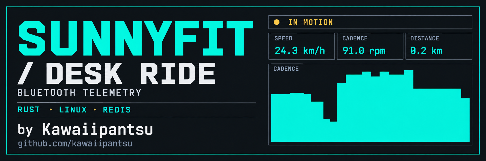
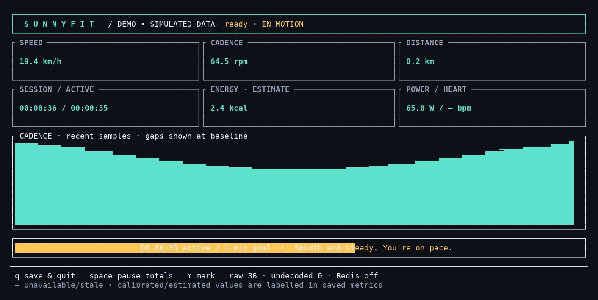
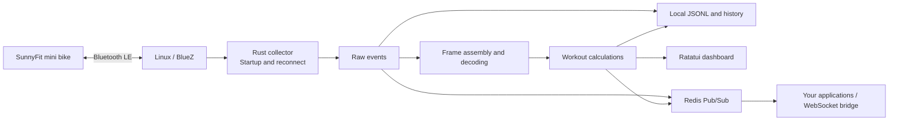

<div align="center">



**Turn a desk ride into a live terminal workout.**

Connect your SunnyFit mini bike. Watch your cadence. Keep a workout history.
Send live telemetry to Redis and build your own dashboards around it.

[](https://apt.thugs.red)


[](LICENSE)

<samp>Rust · Bluetooth LE · Ratatui · JSON · Debian</samp>

[**THUGS(red)**](https://thugs.red) · [**Install from APT**](https://apt.thugs.red) · [**CLI reference**](docs/USAGE.md) · [**Report an issue**](https://github.com/kawaiipantsu/sunnyfit-ble-cli/issues/new/choose)

</div>

## Contents

- [The ride](#the-ride)
- [Inside the terminal](#inside-the-terminal)
- [Install and connect](#install-and-connect)
- [Your data, your tools](#your-data-your-tools)
- [Configuration and history](#configuration-and-history)
- [Architecture](#architecture)
- [Build from source](#build-from-source)
- [Compatibility and verification](#compatibility-and-verification)
- [Documentation](#documentation)
- [Contribute](#contribute)
- [License](#license)

## The ride

| Area | What it does |
| --- | --- |
| **Bluetooth** | Discovers BLE devices, remembers your bike, supports explicit pairing and forgetting, and reconnects with a fresh startup handshake. |
| **Workout** | Live speed, cadence, distance, elapsed and active time, estimated calories, cadence graph, activity goal and encouragement. Pause local totals, mark a moment, or save and quit. |
| **Telemetry** | Decodes the SF-B023005DGY's Sunny protocol, including fragmented packets, operating status and odometer. Standard FTMS and CSC decoders are also included. |
| **History** | Saves raw events, decoded measurements and workout summaries locally. Replay recordings without the bike. |
| **Redis** | Separate, configurable raw, metrics, status and workout channels for downstream dashboards and WebSocket applications. |
| **Headless operation** | Quiet capture by default, simple debug feedback on request, or line-by-line raw JSON with `--debug-stdout -v`. |
| **Debian** | Makefile builds, a `.deb` package, and an optional systemd user service. Packages are distributed through [apt.thugs.red](https://apt.thugs.red). |

## Inside the terminal



Captured from the actual executable in **demo mode**, with simulated measurements
and a one-minute activity goal. The banner above was supplied by the project owner.

| Key | Action |
| --- | --- |
| `space` / `p` | Pause or resume local workout totals |
| `m` | Add a marker to the recording |
| `q` / `Esc` / `Ctrl-C` | Save and exit |

Try the screen without a bike:

```sh
sunnyfit-ble-cli --demo --workout --met 3
```

The TUI renders to stderr; stdout remains available for JSON. Missing or stale
measurements appear as unavailable. Calories are labelled as estimates.

## Install and connect

Configure the THUGS(red) repository using its [APT setup instructions](https://apt.thugs.red/help), then:

```sh
sudo apt update
sudo apt install sunnyfit-ble-cli
sunnyfit-ble-cli doctor
```

Debian packages are delivered through APT rather than GitHub Releases. The current
build targets Debian 13; build from source on an older distribution if needed.

Wake the bike with a few pedal turns and disconnect the phone's SunnyFit app.
Scan, then use the address reported for your bike:

```sh
sunnyfit-ble-cli --adapter hci1 --seconds 20 scan
sunnyfit-ble-cli --adapter hci1 connect AA:BB:CC:DD:EE:FF
sunnyfit-ble-cli --workout
```

Choose the adapter shown by `doctor`; `hci1` is an example. `connect` verifies GATT
access and saves the bike and adapter for subsequent runs.

**The tested SF-B023005DGY streams without a Bluetooth bond.** It rejected native
pairing with `AuthenticationFailed`, so use `connect` for this model. The `pair`
command remains available for devices that support bonding.

```sh
sunnyfit-ble-cli disconnect
sunnyfit-ble-cli forget
sunnyfit-ble-cli --seconds 120 capture
sunnyfit-ble-cli history
```

<details>
<summary>Realtek USB adapter reports missing rtl8761bu_fw.bin</summary>

The kernel already supplies the `btusb` / `btrtl` drivers. On Debian, enable the
`non-free-firmware` repository component and install the firmware:

```sh
sudo apt install bluez firmware-realtek
sudo systemctl start bluetooth
```

Replug the USB adapter, then run `sunnyfit-ble-cli doctor`. An out-of-tree driver
is not required for the tested RTL8761BU adapter.

</details>

## Your data, your tools

| Flags | Capture stdout |
| --- | --- |
| None | Quiet |
| `--debug-stdout` | Simple lifecycle and summary JSON |
| `-v` alone | Quiet |
| `--debug-stdout -v` | Raw and decoded events, one JSON object per line |

```sh
sunnyfit-ble-cli --debug-stdout -v capture > ride.jsonl
sunnyfit-ble-cli replay /path/to/past-workouts/run/events.jsonl
```

For Redis, set a private configuration value or an environment variable:

```sh
export SUNNY_REDIS_URL=redis://127.0.0.1:6379/
sunnyfit-ble-cli --workout
# In another terminal:
redis-cli PSUBSCRIBE 'sunny:bike:*'
```

| Default channel | Payload |
| --- | --- |
| `sunny:bike:raw` | Original packets, reads, writes and acquisition metadata |
| `sunny:bike:metrics` | Decoded samples and periodic workout snapshots |
| `sunny:bike:status` | Connection changes, gaps, retries and markers |
| `sunny:bike:workout` | End-of-session summary |

Local recording continues independently of Redis. Redis reconnects with backoff;
queue drops and failed or unconfirmed deliveries are recorded. Pub/Sub is not a
persistent queue. This build uses plain Redis transports without TLS support.
See the [data and delivery details](docs/USAGE.md#output-and-redis).

## Configuration and history

The first invocation creates a private default configuration and history directory,
including when invoked with `--help`. `XDG_CONFIG_HOME` is respected.

```text
~/.config/sunnyfit-ble-cli/
├── config.toml
└── past-workouts/
    └── <timestamp>-<run-id>/
        ├── manifest.json
        ├── events.jsonl
        └── summary.json
```

Each configuration setting has a CLI override. An override changes only that
setting for the current invocation. Use `--config PATH` for an alternative file.

```sh
sunnyfit-ble-cli --workout --goal-minutes 25 --target-cadence 70
sunnyfit-ble-cli --redis-enabled=false --seconds 60 capture
sunnyfit-ble-cli config
```

New capture directories use mode `0700`, and files use `0600`. Recordings contain
exercise data and BLE identifiers; review and redact excerpts before sharing them.
[Full configuration reference](docs/USAGE.md#configuration-and-history).

## Architecture



Raw packets are retained before interpretation. Each reconnect starts a new
connection epoch and resets counter baselines. Unknown protocol fields remain in
the recording; unavailable power, resistance or battery readings are not invented.
The built-in startup is restricted to the verified model identifier and requests
preservation of existing device session counters.

## Build from source

Rust 1.90+ and Debian build dependencies are required:

```sh
sudo apt install build-essential pkg-config libdbus-1-dev bluez firmware-realtek dpkg-dev python3 redis-server redis-tools
make                 # show available targets
make build           # development executable
make check           # formatting, Clippy, unit and integration checks
make deb             # optimized executable, .deb and checksum under dist/
make demo            # simulated workout screen
```

The integration suite starts an isolated local Redis instance and exercises the
TUI in a pseudo-terminal. `make release FEATURES=vendored-dbus` builds the D-Bus
client library from source. The package includes an optional user service; see
[background operation](docs/USAGE.md#background-service-and-deployment).

## Compatibility and verification

Tested with a **Sunny Health & Fitness SF-B023005DGY**, Debian 13 and a Realtek
RTL8761BU adapter. Live checks covered startup, movement and stopping, forced
disconnect/reconnect, forgetting and remembering the bike. Twelve Rust tests and
the CLI/TUI/Redis integration suite passed; see [the validation record](VALIDATION.md).

The bike supplies speed, cadence, device time, distance, estimated calories,
odometer and status. Heart rate was unavailable, and the observed telemetry did
not supply power, electronic resistance or battery. Standard FTMS/CSC support has
parser tests but has not been verified against additional physical devices.
Long unattended sleep/wake scenarios and other firmware versions remain to be tested.

This is an independent project, not an official Sunny Health & Fitness application.
Protocol research and observed limitations are documented in [PROTOCOL.md](docs/PROTOCOL.md).

## Documentation

| Guide | Contents |
| --- | --- |
| [CLI reference](docs/USAGE.md) | Commands, config, Redis, capture, replay and background service |
| [Protocol](docs/PROTOCOL.md) | GATT sources, startup, frame layout, units and hardware evidence |
| [Validation](VALIDATION.md) | Automated checks, physical-bike tests and remaining limits |
| [Debian deployment](docs/DEPLOYMENT.md) | Package builds, APT workflow and signing responsibilities |
| [Contributing](CONTRIBUTING.md) | Development checks, bug reports and compatibility evidence |

## Contribute

Use the [issue chooser](https://github.com/kawaiipantsu/sunnyfit-ble-cli/issues/new/choose)
for **bugs**, **feature requests**, **bike compatibility**, or **documentation fixes**.
Include the CLI version, distro, relevant hardware and the smallest useful example.
Sanitize logs before posting. See [CONTRIBUTING.md](CONTRIBUTING.md).

## License

The application is [MIT licensed](LICENSE). Dependencies retain their own licenses.
The project does not redistribute SunnyFit APKs or decompiled application source.

---

<div align="center"><samp>THUGS(red) · KEEP PEDALING · KEEP YOUR DATA · BUILD YOUR OWN TOOLS</samp></div>
